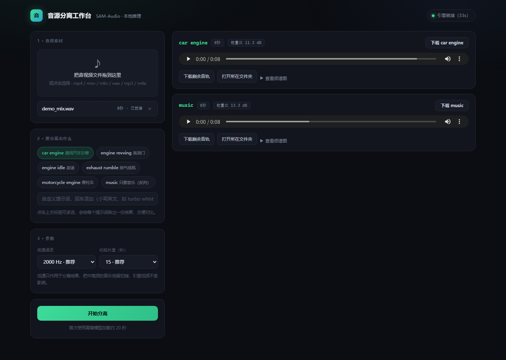

# 音源分离工作台

用一句英文描述，从混音里把想要的声音抠出来 —— 比如把**汽车引擎声**从音乐里分离出来。

基于 Meta 的 [SAM-Audio](https://github.com/facebookresearch/sam-audio)（flow matching + DiT，文本提示分离），
自带一个本地 Web 界面和一整套长音频切段推理的工程实现。



> **English**: A local workbench for text-prompted audio source separation, built on Meta's SAM-Audio.
> Drop in a video/audio file, type `car engine`, and get a clean isolated engine track.
> Includes a zero-dependency web UI, chunked inference for long files, and a low-pass stage that
> removes music bleed without touching engine low-end. Docs are in Chinese.

---

## 为什么不用 Demucs / UVR5 / Spleeter

Demucs、Spleeter、UVR5 都是**音乐分轨**模型，训练集是 MUSDB18，只有 4 类：
`vocals / drums / bass / other`。引擎声不在训练分布内，会被打散塞进 `drums` 和 `other`；
而引擎声主能量集中在 20–500 Hz，正好压在贝斯和底鼓上，频谱掩码方法无法区分。
结果必然是「一半引擎声留在鼓轨、一半音乐残留进引擎轨」。

SAM-Audio 走**文本提示 + 生成式分离**，理解语义而不是频段。

---

## 特性

- **图形界面**：拖进文件 → 点一下 → 在线试听 / 下载，带进度、取消、频谱对比图
- **上传即转码**：312 MB 的 128 秒视频 2 秒落地成 18 MB 单声道音频，原视频不占盘
- **长音频免爆显存**：按 15 秒切段 + 1 秒重叠交叉淡化，128 秒素材 10 段 24 秒跑完
- **低通净化**：一键切掉 2 kHz 以上的音乐残留，实测残留降 52 dB 而引擎低频损失 0.0 dB
- **多提示词对比**：一次跑 `car engine` / `engine revving` / `exhaust rumble`，挑最干净的
- **零外部依赖的前端**：一个 HTML 文件，无 CDN、无构建、无框架

---

## 快速开始

### 0. 前置

- Python 3.12、CUDA 12.8+ 的 PyTorch（RTX 50 系需要 `sm_120` 支持）
- `ffmpeg` 在 PATH 里
- 显存 ≥ 8 GB（切段 15 秒时模型常驻 5.6 GB）

### 1. 拉上游代码

```bash
git clone https://github.com/facebookresearch/sam-audio.git sam-audio
git clone https://github.com/<you>/audio-source-separator.git
cd audio-source-separator            # 本仓库的脚本要放在 sam-audio 的上一级
```

目录结构应该是这样：

```
你的工作目录/
├── ui.py  batch.py  separate.py  web/          ← 本仓库
├── models/sam-audio-small/                      ← 模型（自己下，见下）
├── models/pe-a-frame-large/                     ← span 模型
├── hf_cache/                                    ← 文本编码器等，自动生成
└── sam-audio/                                   ← 上游仓库
    └── .venv/
```

### 2. 建虚拟环境

```bash
cd sam-audio
uv venv --python 3.12 .venv
. .venv/Scripts/activate           # Windows；Linux 用 source .venv/bin/activate
uv pip install torch torchaudio --index-url https://download.pytorch.org/whl/cu128
uv pip install -e .
```

依赖坑不少（`iopath` 源码构建、`audiobox_aesthetics` 会把 torch 换成 CPU 版、
`audiotools` 的 PyPI 名是 `descript-audiotools`……），完整清单见文末「安装踩过的坑」。

### 3. 下模型

| 组件 | 来源 | 大小 |
|---|---|---|
| `sam-audio-small` | `mrfakename/sam-audio-small`（非 gated 镜像）或官方 `facebook/sam-audio-small` | 5.1 GB |
| `pe-a-frame-large` | `facebook/pe-a-frame-large` 的 **`perception_models`** revision | 6.1 GB |
| t5-base / CLAP | HuggingFace 缓存，首次运行自动下 | 约 2.7 GB |

放到 `models/sam-audio-small/checkpoint.pt`、`models/pe-a-frame-large/`。
`pe-a-frame-large` 若是软链接形态，需要先硬链接实体化，否则离线加载会报 `LocalEntryNotFoundError`。

### 4. 打两个补丁（必须，否则跑不起来）

`sam_audio/model/base.py` — 给 `_from_pretrained` 的
`cache_dir` / `proxies` / `resume_download` / `token` 参数加默认值
（huggingface_hub 1.33 调用时不再传这些参数，原签名会 `TypeError`）。

`models/sam-audio-small/config.json` — 改三处：

```jsonc
{
  "text_encoder": { "name": "google-t5/t5-base" },   // transformers 5.x 不再补 google- 前缀
  "span_predictor": "<绝对路径>/models/pe-a-frame-large",  // 必须写目录路径，不能写 repo id
  "visual_ranker": null,
  "text_ranker": null
}
```

为什么要写绝对路径：`PEAudioFrame.from_config` 对非目录参数会拼 `facebook/` 前缀并请求
`revision="perception_models"`，离线模式下缓存里没有该 revision 就直接抛异常；
改成目录后走 `os.path.isdir` 分支，彻底脱离 HF 缓存。

### 5. 启动

```
双击 启动界面.cmd
```

浏览器会自动打开 `http://127.0.0.1:8899`。首次启动等约 30 秒加载模型，之后每个任务都省掉这段时间。

---

## 用法

### 图形界面

| 步骤 | 说明 |
|---|---|
| 1 · 选择素材 | 拖入视频或音频（mp4/mov/mkv/wav/mp3/m4a），服务端立刻转成 48 kHz 单声道，丢弃原文件 |
| 2 · 要分离出什么 | 点标签多选，也可自己敲小写英文短语回车添加 |
| 3 · 参数 | 低通 `2000 Hz`、切段 `15 s`，默认值即可 |
| 4 · 开始分离 | 右侧看进度，跑完在线试听、下载、看频谱图 |

### 命令行

```bash
# 单个文件（有 40 秒硬上限，整段推理显存随长度线性增长）
sam-audio/.venv/Scripts/python.exe separate.py a.mp4 -p "car engine"

# 批量 / 长音频（自动切段）
sam-audio/.venv/Scripts/python.exe batch.py 素材目录 -p "car engine" --lowpass 2000

# 一个文件多试几个提示词
sam-audio/.venv/Scripts/python.exe batch.py a.mp4 -p "car engine" "engine revving"
```

输出 `<提示词>__target.wav`（要的声音）和 `<提示词>__residual.wav`（剩下的），48 kHz / 24 bit / 单声道。

---

## 实测数据

### 分离质量（RTX 5070 12 GB）

合成样本：Subaru 引擎录音 + Antti Luode 音乐，线性混合成单声道。参考源已知，可算客观指标。

| 信号对 | SI-SDR (dB) |
|---|---:|
| 混合原始音 vs 引擎参考 | **-0.87** ← 未分离基线 |
| target vs 引擎参考 | **+8.52** ← 净提升 9.4 dB |
| target vs 音乐参考 | -26.29 |
| residual vs 音乐参考 | +9.12 |
| residual vs 引擎参考 | -24.10 |

频谱幅度谱相关性：target↔引擎 **0.970**、residual↔音乐 0.972、target↔音乐 0.301。

### 低通净化

以本机 128.81 秒素材的分离结果为输入，实测 6 阶零相位低通对各频段的影响：

| 低通 | 20–250 Hz 引擎低频损失 | 2k–12 kHz 残留衰减 | 总响度变化 |
|---|---:|---:|---:|
| 1500 Hz | 0.00 dB | -16.0 dB | -0.25 dB |
| **2000 Hz** | **0.00 dB** | **-4.0 dB** | **-0.04 dB** |
| 3000 Hz | 0.00 dB | -0.1 dB | -0.00 dB |

要点是**引擎低频一点不掉**（20–250 Hz 变化 0.00 dB），所以默认开着不亏。
素材本身越脏、分离残留越多，这一级收益越明显。

顺带一个反直觉的发现：分离本身已经把 2k–12k 压低了 **21.7 dB**
（原音 -34.2 dB → 目标 -55.9 dB），所以低通更像是保险而不是主力。
如果分离后中高频本来就很干净，它的作用会很小。

### 速度

| 场景 | 耗时 |
|---|---|
| 模型加载 | 32–36 s（显存 5.6 GB） |
| 24 s 音频（2 段） | 13 s |
| 128.8 s 视频（10 段） | 24 s |
| 上传 312 MB / 128 s 视频 | 2 s（转成 18 MB 音频） |

关键优化：`use_spans=False` 时把 6.12 GB 的 span 模型 `.to("cpu")`，
显存 11.4 GB → 5.6 GB，不再因显存吃满而降速。早期版本同一文件要 236 s。

---

## 提示词怎么写

**必须是小写英文名词短语**（文本编码器是 t5-base，只吃英文，也不吃整句）。
`car engine` ✅ / `帮我提取引擎声` ❌

| 想要 | 提示词 | 备注 |
|---|---|---|
| 汽车引擎（通用） | `car engine` | **最稳**，段间标准差 6.4 |
| 怠速 | `engine idle` | 对持续转速的素材容易把引擎也削掉（标准差 45.8） |
| 轰油门 | `engine revving` | 转速起伏明显时更准 |
| 排气 | `exhaust rumble` | 更闷更低沉，但不稳定（标准差 26.0） |
| 摩托车 | `motorcycle engine` | |
| 只要音乐 | `music` | 反向取，把引擎当残留 |

**不要用整体均值挑提示词**，要看段间标准差 —— 均值好看但逐段跳变的方案听感很差。

---

## 参数

| 参数 | 默认 | 说明 |
|---|---|---|
| `-p` / `--prompt` | 必填 | 目标声音，可多个 |
| `--lowpass HZ` | 无 | 对结果做低通，**建议 2000** |
| `--spans` | 关 | 自动定位发声时段。**实测在「全程持续」的素材上掉 2.2 dB**，音乐多漏 10 dB；只有声音时有时无时才值得试 |
| `--chunk` | 15 | 切段长度（秒），爆显存就调 8 |
| `--overlap` | 1.0 | 段间重叠（秒），防拼接爆音 |
| `--purify` | — | **实测无效**：二次净化把引擎低频一起削掉 5.9 dB，音乐占比反升 3.5 dB |
| `--rerank` | 固定 1 | **不要开**，见下 |

### 为什么 rerank 必须保持 1

官方 rerank 是 ensemble（CLAP 权重 5.0 + Judge 权重 1.0）。CLAP 只衡量「这段音频像不像 car engine」，
不衡量分离干不干净；缺了 Judge 这一环，单靠 CLAP 会选中「引擎味更足但同时混进更多音乐」的候选。

| 配置 | tgt↔引擎 | tgt↔音乐 | res↔音乐 | 耗时 |
|---|---:|---:|---:|---:|
| **rerank=1** | **8.52** | **-26.29** | **9.12** | **42 s** |
| rerank=4（仅 CLAP） | 5.86 | -17.83 | 6.53 | 548 s |

慢 13 倍且质量全面下降。要正确启用必须同时具备 Judge 模型（gated，12 GB），本机显存放不下。

---

## 已知限制

- 只输出**单声道**
- 分离内部有随机噪声初始化，同一段音频跑两次波形不同（指标浮动约 ±1 dB）；效果不理想直接重跑
- 输出保留原始电平（峰值约 0.4），没做响度归一化
- 界面同一时刻只跑一个任务（GPU 独占）

---

## 安装踩过的坑

1. `iopath` 0.1.10 源码构建会触发 Windows safe-delete hook 阈值 → 用 `--only-binary` 装 0.1.9
2. `audiobox_aesthetics` 会把 torch 降级成 CPU 版 → 必须 `--no-deps` 装
3. `audiotools` 的 PyPI 名是 `descript-audiotools`（import 名才是 `audiotools`）
4. `pytorchvideo` / `wget` / `randomname` 无 wheel，需允许源码构建；`pytorchvideo` 走 git
5. 全局 `huggingface-hub` 2.x 与 `transformers` 5.x 冲突 → venv 内锁到 1.33.x
6. 逐包 `--no-deps` 会漏依赖 → 写个脚本「缺什么装什么」迭代补齐
7. `HF_HOME` 必须写 **Windows 路径**（`D:/...`），Git Bash 的 `/d/...` Python 认不出
8. 离线模式下必须 `HF_HUB_OFFLINE=1` + `TRANSFORMERS_OFFLINE=1`，否则会卡在失效代理的连接超时上

---

## 目录

```
ui.py             Web 后端（http.server，无额外依赖）
web/index.html    全部前端（单文件，内联 CSS/JS）
batch.py          切段批量推理、低通、编码解码
separate.py       单文件分离（40 秒上限）
remux.py          把分离音轨合回视频（-c:v copy 不转码）
eval.py           用已知参考源算 SI-SDR
启动界面.cmd       双击启动 Web 界面
分离.cmd          拖拽文件直接跑 batch.py
```

---

## License

本仓库的代码（`ui.py`、`batch.py`、`separate.py`、`remux.py`、`web/`、文档）采用 **MIT**。

**不含**上游代码与模型权重：`sam-audio` 由 Meta 以
[SAM License](https://github.com/facebookresearch/sam-audio/blob/main/LICENSE) 发布，
模型权重同理，请自行下载并遵守其条款。
